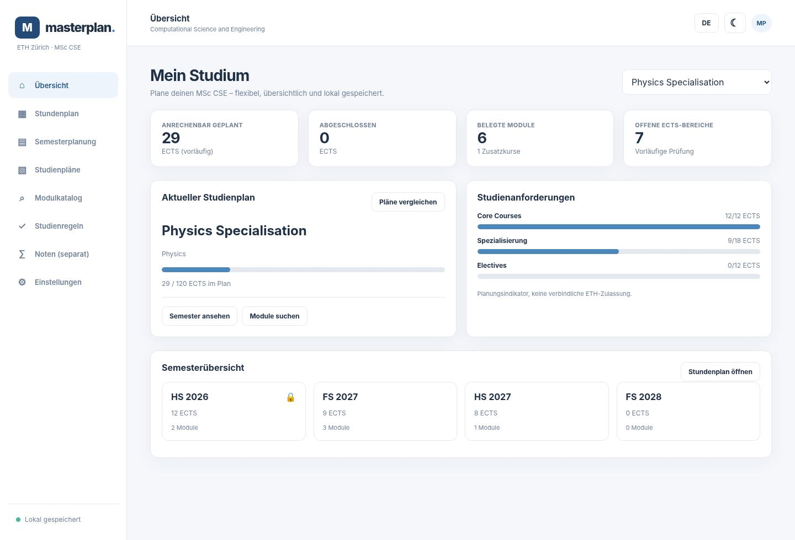
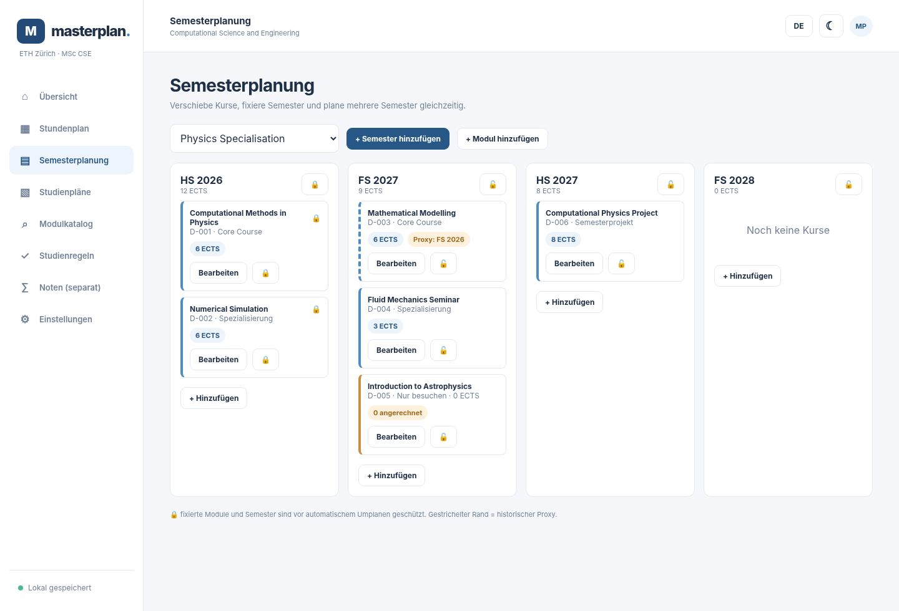
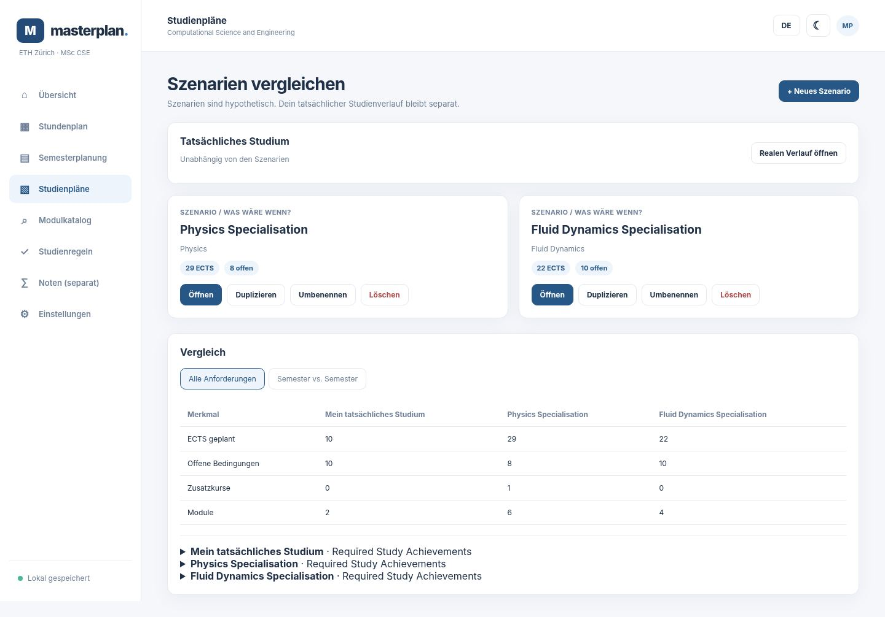
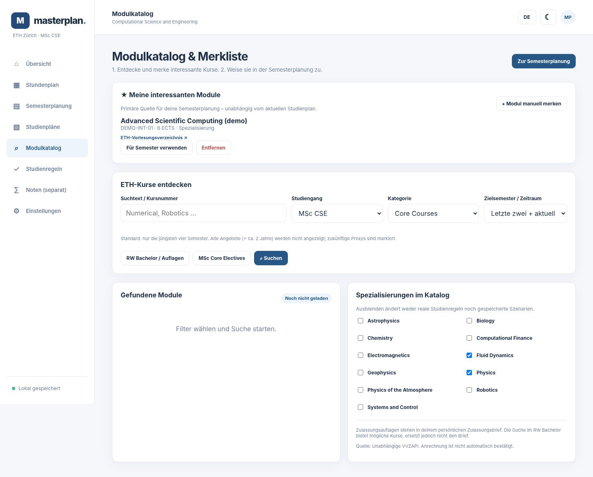
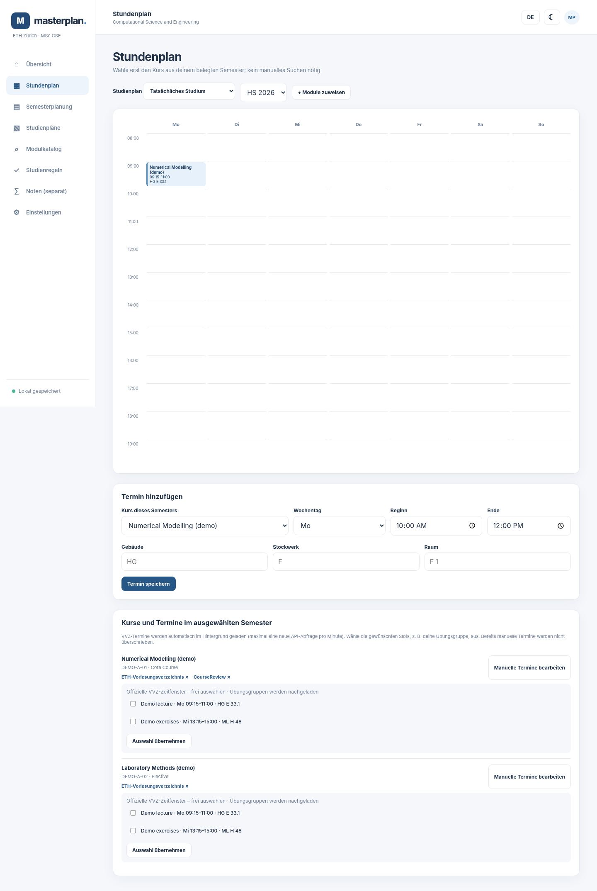
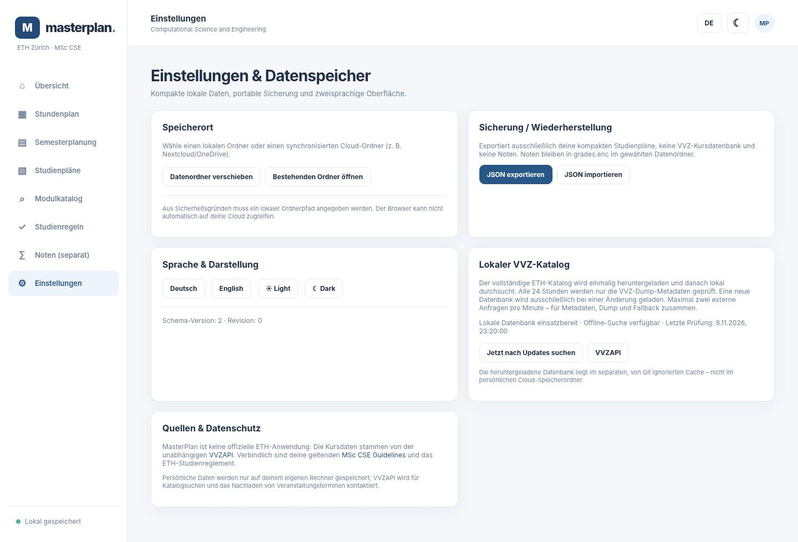

# MasterPlan

A local-first, bilingual study planner for the ETH Zurich MSc Computational Science and Engineering programme. **Academic Minimal** UI, no Node.js, Docker or frontend build needed.

> **Status: usable early MVP, not a finished official degree audit.** Course searches use the independent [VVZAPI](https://github.com/markbeep/vvzapi); study requirements are provisional starter thresholds. No ETH affiliation or warranty. Always verify credit eligibility, registration, examination schedules and the binding personal regulations with ETH.

## Start / Starten

**Ubuntu/Linux and macOS** (Python 3.10+):

```sh
sh run.sh
```

**Windows** (Python 3.10+): double-click `run.bat`. It opens `http://127.0.0.2:8765/`. A browser-only hosted edition and standalone installers are **not yet provided**. Use `python3 server.py --no-browser --port 8765` for headless operation.

The default bind address is **`127.0.0.2:8765`** (as requested). If this loopback alias is unavailable on Windows/macOS, MasterPlan automatically falls back to `127.0.0.1:8765` and prints the actual URL. Override with `sh run.sh --host 127.0.0.1` when needed. Only loopback connections are supported.

**German:** `sh run.sh` starten und `http://127.0.0.2:8765/` öffnen. Keine Kommandozeile ist für die Nutzung der Weboberfläche erforderlich, wenn die App schon läuft. Für den ersten lokalen Start wird Python benötigt. Windows: `run.bat` doppelklicken.

## Fehlerbehebung beim Start / Startup troubleshooting

Wenn `FileNotFoundError: guidelines/cse-guidelines.json` erscheint, fehlt eine **Projektdatei** – es handelt sich weder um ein Python-Paket noch um einen VVZ-Fehler. Bitte nicht versuchen, die Datei mit pip zu installieren.

Prüfe insbesondere, ob der ausgeführte `server.py` tatsächlich aus dem gewünschten Ordner stammt:

```sh
cd ~/Nextcloud/masterplan
pwd -P
readlink -f run.sh
readlink -f server.py
ls -l guidelines/cse-guidelines.json
git status --short
```

Wenn in der Fehlermeldung `~/.local/share/Trash/files/...` auftaucht, liegt oft eine unvollständige Kopie oder ein Symlink auf den Papierkorb vor. Lösche **keine** vorhandenen `user-data/`-Dateien oder persönlichen Backups. Klone stattdessen für die Diagnose eine vollständige Kopie:

```sh
cd ~
git clone https://github.com/Saxermi/masterplan.git masterplan-clean
cd masterplan-clean
sh run.sh
```

MasterPlan benötigt Python 3.10+. Ein installiertes Anaconda-Python 3.9 kann `python3` im PATH überlagern. `run.sh` prüft nun die Interpreter-Version und sucht alternativ nach `python3.10` bis `python3.14`. Du kannst explizit starten mit `MASTERPLAN_PYTHON=python3.14 sh run.sh`; ein gewöhnliches `python3 --version` mit 3.14 ist bereits geeignet.

## Implemented / Umgesetzt

- Bilingual **Deutsch / English**, Academic Minimal light/dark interface and responsive PWA manifest.
- Named study scenarios: create, duplicate, switch, rename, delete, compare, per-plan semester columns.
- Local course records, manual events with building/floor/room, time clash detection and shared completed-course history.
- Course/semester locks, interest-only courses (always **0 credited ECTS**), preliminary credit categories.
- **Offline-first VVZ dump**: one complete SQLite database snapshot (ZIP) is downloaded on first start, stored under a gitignored cache directory, and reused across restarts for course search, details, exercise groups and timetable slots. Same-season historical proxies and all existing programme/category filters remain available. Upstream calls are globally limited to **one request per minute**.
- Separate grade page with a password-encrypted `grades.enc` (AES-GCM via browser WebCrypto; PBKDF2 250,000 iterations), component-weighted estimates. No grades outside that page.
- Minimal local JSON, atomic revisions, independent encrypted grade storage, JSON plan export/import, portable data folder (can be inside a cloud-sync folder). Open/move folders through Settings.
- Configurable guideline JSON + schema for a future external extraction agent. Includes starter study-progress indicators, not full curriculum adjudication.

## Not yet implemented / Noch offen

- Validated autonomous PDF-guidelines extraction/approval pipeline, full legal applicability and admission checks, exact seminar validation and final official graduation grade.
- Complete event reconciliation and automatic updates of previously chosen personal slots remain conservative: VVZ schedule changes are flagged, but never silently overwrite selected or manual slots. Some by-appointment or date-specific events have no weekly slot and must be handled manually.
- Cloud merge/conflict resolution between two simultaneous editing devices. **Do not edit the same cloud-synced folder from two computers at once**; sync fully before switching.
- Cloud-hosted deployment, automatic desktop installers, production accounts and hosted multi-user security. This server is **local loopback only**.
- Comprehensive unit/integration/browser test suites and continuous release/distribution.


## Feedback revision (November 2026) / Überarbeitung

- **Real study progress vs scenarios** / **Tatsächlicher Verlauf vs Szenarien**: dashboard and top semester board now show actual progress, while named hypothetical specialisation scenarios are separate below; the former is never overwritten when switching scenario.
- **Shortlist first** / **Erst Merkliste**: catalogue results can be shortlisted, then assigned from a dropdown in Semester planning. Assigned courses can be unselected without deleting their shortlist entry. The timetable add-event form selects only courses already assigned to its semester.
- **Study programme/category/term filters**: MSc CSE is default, and its official section path is distinct from the RW/CSE Bachelor; category filters support Core Courses, Electives, specialisations, case studies, semester projects, Science in Perspective, master thesis and Scientific Works (zero credits). Separate RW Bachelor admission requirements are tracked **outside** MSc ECTS. The default recent-term window is previous two / current / next. Historical same-season proxies are labeled.
- **Specialisation filters**: selected specialisations narrow VVZ section-path search; empty selection yields no specialisation results. Eligible ETH MSc core-course programmes can be searched as potentially creditable CSE electives, subject to individual recognition.
- **Required Study Achievements** on actual dashboard and per scenario: 120 total; 74 main-area credits; two core courses ≥12 ECTS; four specialisation lectures and one seminar ≥18 ECTS; two electives ≥12 ECTS; two case studies (3 ECTS each); term project 8; SiP 2; thesis 30; Scientific Works prerequisite at Bachelor/Master level, and separately selected admission conditions. Core Courses **Advanced Machine Learning** and **Probabilistic Artificial Intelligence** may not both count as cores. Figures are provisional because individual regulations and actual credit approval must be checked.
- **Graduation grade formula** from MSc-CSE Guidelines §3.3 (p. 10): `(2*core1 + 2*core2 + SUM(four specialisation lecture grades) + SUM(all included elective grades) + 4*thesis_grade) / (12 + number_of_included_electives)`. Each module's internal component grades may first be averaged by its own assessment weights. Grade values never appear outside the private grade page.
- **Actual VVZ timetable** / **Termine aus VVZAPI**: `/api/v1/course/get/{id}` gives real weekday/start/end/building/floor/room, and `/api/v1/unit/{id}/get` includes exercise groups. They are read locally from the installed VVZ dump (or fetched through the shared one-per-minute API fallback while the dump is missing), with selectable timeslots and room data; API source/link, historic proxy flag, and optional CourseReview link appear on linked modules. No synthetic times are inserted into personal data.
- **Course links** / **Verlinkungen**: direct official ETH VVZ for an identified learning unit, or official VVZ number search as fallback; CourseReview links appear only if VVZAPI reports a CourseReview rating. CourseReview is not affiliated with ETH.

Run the optional browser UI regression test with `python3 tests/browser_smoke.py` (developer dependency Playwright/Chromium only). It uses mocked local responses and synthetic course data; no personal data or live API traffic.

### Limitations / Grenzen

The full Guidelines extraction agent is still a future component; a manually reviewed machine-readable rule starter is used, not a binding graduation audit. Programmatic identification of the exact *anrechenbar* course category from the student's admission ruling requires manual confirmation. VVZ timeslots missing times or listed only "by appointment" cannot be rendered as weekly recurring events. Auto-scheduling exercise groups is deliberately opt-in because group selection is personal. A public hosted edition/desktop installer is still not delivered.

## Storage / Datenspeicher

Default: `./user-data/masterplan.json` and (only if grades are saved) `./user-data/grades.enc`. Use environment variable `MASTERPLAN_DATA_DIR` before starting, or Settings → Move/Open data folder (path can be a Nextcloud/OneDrive/iCloud/Dropbox local sync folder). JSON stores personal selections rather than huge VVZ catalogues. Personal data paths are in `.gitignore`. Export and import covers study plans, **not** the grade vault. Back up both files together; loss of the grade password makes the grade vault unrecoverable. The web app is local HTTP, not automatically authenticated to any cloud service.

## VVZ data integration / Offline-Dump

**New workflow / Neue Funktionsweise:**

1. On the first start, the local server fetches the small `GET https://vvzapi.ch/api/v1/dump/metadata` JSON (size and `last_modified_ms`). Only if no valid database is installed, or if the metadata changed, it downloads `GET https://vvzapi.ch/api/v1/dump` as a ZIP. Downloaded bytes are streamed to disk instead of held in memory.
2. The ZIP is checked for expected size, SQLite format, required schema and `PRAGMA quick_check`. Only after a successful validation does an atomic replacement make the new snapshot active. A corrupt or failed download leaves the previously working snapshot usable.
3. Course catalogue searches, MSc CSE / RW Bachelor / other programme filters, category/section filters, semester and historical-proxy choices, learning-unit details and real lecture/exercise-group timeslots are then queried **locally** using SQLite. No VVZ HTTP requests are needed during normal browsing.
4. The app checks **only metadata** at most once every **24 hours** (and on explicit user request in Settings → Offline VVZ catalogue). If size *and* last modification timestamp are unchanged, the ZIP is **not downloaded again**. Metadata is persisted, so this also survives server restarts. Offline searches remain available while a new snapshot is being downloaded.
5. A single server-wide limiter covers metadata, ZIP downloads and the temporary online fallback: **maximum one request per minute**, implemented as one reservation every 60 seconds. The VVZ dump endpoint itself permits up to 2/minute; MasterPlan deliberately stays below that limit. The initial download may therefore start 60 seconds after its metadata request. If the dump is unavailable, the previous on-demand VVZ API fallback remains available, but is also throttled.

**Persistence / Speicherort:** Default `.cache/vvz/database.sqlite` and `.cache/vvz/metadata.json` in the app directory; override with `MASTERPLAN_CACHE_DIR=/your/cache/folder`. This cache is disposable and **is never copied into `MASTERPLAN_DATA_DIR`** (your personal portable/cloud-sync folder). It is covered by `.gitignore`, along with temporary ZIPs and local SQLite files. All actual study plans and encrypted grades are stored separately.

**Endpoints / API:** `GET /api/vvz/dump/status` displays database availability, phase, size and last check; `POST /api/vvz/dump/check` forces a background metadata check. The original `/api/vvz/search`, `/api/vvz/unit/{id}` and `/api/vvz/times/{id}` keep their response formats and prefer the local database.

**Source:** VVZAPI is an independent, community-maintained project at [markbeep/vvzapi](https://github.com/markbeep/vvzapi). Its ZIP endpoint is rate-limited; metadata is the documented way to avoid needless downloads. The local dump is not an authoritative statement of individual course eligibility. Always confirm planned lectures and recognition using the official ETH VVZ and your current regulations.

**Offline note:** The installation needs network access for the initial dump. While the download runs, legacy API fallback queries might be rate-limited; if both are unavailable the UI explains the status. A cached snapshot works offline. The dump's freshness is checked only while the local server is running or the user explicitly asks. The downloadable archive can be large, depending on the upstream data. The application has no automatic cloud-sync conflict resolution.

## Guidelines agent contract

An external agent should produce `guidelines/cse-guidelines.json` conforming to `guidelines/cse-guidelines.schema.json`. Each confidently extracted rule should include provenance (page and document source), regulation applicability and extracted text. The checked starter file has `sourceChecked: false`, and unknown data must not be invented. The app reads the configured thresholds but **does not automatically grant official academic recognition**. Do not commit private documents or personal records.

## Development / Entwicklung

Python standard library only. Run tests with `python3 -m unittest discover -s tests -v`. To adjust listening port, use `sh run.sh --port 9000`. To stay on loopback, do not change the bind address to `0.0.0.0` unless you add authentication and proper security controls. The built-in HTTP server is **not suitable for untrusted public hosting**.

Project tree:

```
server.py                 local server, file persistence, VVZAPI proxy
web/                      semantic HTML, responsive CSS, browser JavaScript
guidelines/               machine-readable rule contract + starter rules
tests/                    server logic and storage tests
run.sh / run.bat          single-command/double-click startup
user-data/                private local data, gitignored (created on first run)
```

## Design values

Low data footprint, no grade leakage, no silent overwriting of locked semesters, clear differentiation of **planned** and **completed**, explicit historic proxies and visible uncertain academic recognition.

## Screenshots / Bildschirmfotos

Browser-rendered captures of the real Academic Minimal frontend using **synthetic demo data**, not real student records. They are intentionally kept separate from `user-data/`.

| Dashboard | Semester planning |
| --- | --- |
|  |  |

| Plan comparison | ETH module catalogue |
| --- | --- |
|  |  |

To regenerate: `python tests/create_screenshots.py` (optional developer dependency `playwright` plus Chromium, not required for normal users). Screenshots are taken from actual frontend HTML/CSS/JavaScript with a mocked backend; no production data, grades, or ETH API results are involved.

| Automatic VVZ timetable and optional CourseReview links |
| --- |
|  |


### CSE elective core-course filter / CSE-Elective-Core-Filter

The catalogue includes **“MSc Core Courses → CSE Electives”** with a one-click option to browse all eligible Master's programmes or narrow to one programme. The eligible study programmes are Statistics, Physics, Computer Science, Mathematics (including Applied Mathematics), Neural Systems and Computation, Robotics, Systems and Control, Data Science, and Electrical Engineering and Information Technology. This list follows the [MSc CSE Guidelines, section 3.6, p. 19](https://ethz.ch/content/dam/ethz/special-interest/study-programme-websites/ms-compsci-and-eng-dam/documents/master-programme/MSc-CSE-Guidelines.pdf). It uses VVZAPI section-path filters, with **Core Courses**, not general elective labels.

A filtered course is **potentially eligible without prior approval**, not guaranteed to be credited: exclusions such as previous Bachelor credit use, category duplication, personal study regulations, and current VVZ classifications still apply. The study planner does not submit ETH credit requests. / Ein Treffer bedeutet **grundsätzlich ohne vorgängige Bewilligung wählbar**, nicht automatisch angerechnet. Vorherige Bachelor-Anrechnung, Doppelzählungen, persönliche Reglementsfassung und aktuelle VVZ-Einstufung müssen geprüft werden.

The **Study plans → Semester vs. semester** view allows comparing any two semesters from the same or different plans side by side, including common/unique modules, category/ECTS/status differences, locked and extra courses. This UI-only selection does not increase the saved study-plan file size. / Unter **Studienpläne → Semester vs. Semester** können zwei beliebige Semester aus gleichen oder unterschiedlichen Plänen modulweise verglichen werden.

### Offline VVZ catalogue / Lokaler VVZ-Katalog



The screenshot uses mocked, non-personal data. The UI reports whether the local SQLite dump is available and allows an explicit metadata check without downloading an unchanged archive.
