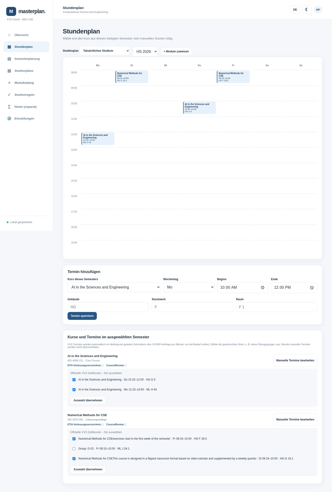

# HS26: Reparatur und geprüfter Beispielplan

Geprüft am 8. November 2026 mit dem öffentlichen VVZAPI-Dump
(`last_modified_ms=1794100262653`, ZIP: 59.895.371 Bytes) und den offiziellen ETH-VVZ-Seiten.
Der Beispielplan enthält keine persönlichen Studien- oder Notendaten.

## Testfall

[Importierbarer Beispielplan](examples/hs26-ai-numerical.json). Zum Ausprobieren eine separate
Datenablage verwenden, z. B. `MASTERPLAN_DATA_DIR=./demo-data sh run.sh`, und den Plan unter
Einstellungen importieren. Ein Import ersetzt den Planinhalt der gewählten Datenablage.

| Modul | Nummer | Rolle | ECTS | Semester |
| --- | --- | --- | ---: | --- |
| AI in the Sciences and Engineering | 401-4656-21L | Core Course | 6 | HS26 |
| Numerical Methods for CSE | 401-2673-00L | Zulassungsauflage | 9, separat vom MSc | HS26 |

Die Suche versteht auch „AI Science and Engineering“ und
„Numerical Methods for Computational Science and Engineering“.

| Modul | Wochentag | Zeit | Raum |
| --- | --- | --- | --- |
| AI: Vorlesung | Donnerstag | 10:15–12:00 | HG G 5 |
| AI: Übung | Montag | 12:15–14:00 | ML H 44 |
| Numerical Methods: Vorlesung | Dienstag | 08:15–10:00 | HG G 19.1 |
| Numerical Methods: gewählte Übung | Freitag | 08:15–10:00 | HG F 26.5 |

**Raum-Ausnahme:** Numerical Methods findet laut ETH-Kommentar in der ersten Vorlesungswoche
in HG G 5 statt, danach in HG G 19.1. Der Beispielplan bildet den normalen Wochenrhythmus ab.
Die zweite angebotene Übungsgruppe ist eine Alternative und wurde nicht zusätzlich eingeplant.

Quellen: [AI im ETH VVZ](https://www.vvz.ethz.ch/Vorlesungsverzeichnis/lerneinheit.view?lerneinheitId=204828&semkez=2026W&ansicht=ALLE&lang=en),
[Numerical Methods im ETH VVZ](https://www.vvz.ethz.ch/Vorlesungsverzeichnis/lerneinheit.view?lerneinheitId=204354&semkez=2026W&ansicht=ALLE&lang=en).
Die Rolle „Auflage“ stammt aus dem gewünschten Testfall; die individuelle Anerkennung folgt dem Zulassungsbrief.

## Ursachen und Änderungen

- Gleichzeitige Browser-Speicherungen verwendeten dieselbe Revision. Schreibvorgänge laufen jetzt
  nacheinander; echte externe Konflikte laden den aktuellen Stand und melden die erneut nötige Änderung.
- Geschlossene Verbindungen lösten beim Senden einer Fehlerantwort weitere Fehlerantworten aus.
  Verbindungsabbrüche beenden jetzt die Antwort ohne weiteren Schreibversuch.
- Der Dump liefert Tabellen ohne Indizes. Die Installation und vorhandene Snapshots erhalten lokale
  Indizes. Abschnittsfilter werden einmal ausgewertet statt für jede Lerneinheit erneut durchsucht.
- Studiengang, Kategorie und Spezialisierung gehören zum selben Abschnittspfad und zum ausgewählten
  Angebot. Ein später umklassifizierter Kurs erscheint nicht wegen einer alten Kategorie.
  „Physics“ trifft weder „Geophysics“ noch „Physics of the Atmosphere“.
- Titel, Credits und Unit-ID stammen aus demselben Zielsemester. Historische Proxys bleiben markiert.
  Verspätete Suchantworten überschreiben keine neuere Suche. Ergebnislisten haben Seitennavigation.
- 3014 von 3017 HS26-Veranstaltungen hatten im geprüften Dump keine `Course.timeslots`.
  Fehlende Wochenzeiten werden im Hintergrund aus dem offiziellen ETH VVZ ergänzt und lokal
  unter dem Katalog-Cache gespeichert, für 24 Stunden wiederverwendet und nach Neustarts weitergenutzt.
  Datumsspezifische und unregelmäßige Angaben werden nicht als regelmäßige Termine erfunden.
- Während der Erstinstallation wartet die Suche auf den lokalen Katalog, statt den gemeinsam
  begrenzten API-Zugang mit fachlich ungenauen Compact-Suchen zu belegen. Einstellungen zeigt den Status.
  Die globale Begrenzung von einer externen Anfrage pro Minute bleibt bestehen; erstmaliges
  Nachladen mehrerer fehlender Stundenpläne kann daher mehrere Minuten dauern.

## Prüfung

- `python3 -m unittest discover -s tests -v`: 31 Tests.
- `python3 tests/browser_smoke.py`: Browserprüfung einschließlich schneller Speicherfolgen,
  echtem 409-Konflikt, Wiederaufnahme nach Konflikten und vertauschter Suchantwort-Reihenfolge.
- `python3 tests/browser_hs26.py --database /path/to/database.sqlite`: echte lokale HTTP-Endpunkte,
  echter Dump und öffentliche ETH-Stundenplan-Fixtures; Suche, Vormerken, Zuweisung, Terminauswahl,
  Kategorien, ECTS und Wiederherstellung nach Neuladen.
- Offizieller ETH-Abruf zusätzlich live mit dem produktiven Client geprüft; anschließend Cache-Nutzung
  nach Neuerstellung des Clients ohne erneuten Netzwerkabruf.

Gemessene lokale Suchzeiten nach Indexaufbau (Median von 10 Läufen, diese Cloud-Umgebung,
kein Netzwerk in den Messungen):

| Suche für HS26 | Treffer | Median |
| --- | ---: | ---: |
| CSE Core Courses | 4 | 13,55 ms |
| AI Science and Engineering | 1 | 14,09 ms |
| Numerical Methods, Auflagen | 1 | 16,58 ms |
| Alle wählbaren MSc-Core-Programme | 110 | 101,03 ms |

Die Messungen sind keine Geschwindigkeitsgarantie für andere Rechner. Der erste Indexaufbau
benötigte hier rund 0,18 Sekunden. Der vollständige ETH-Dump bleibt als wiederverwendbare Quelle
lokal; fachfremde Abschnitte werden durch die präzisen Studiengangfilter aus CSE-Ergebnissen ausgeschlossen.
