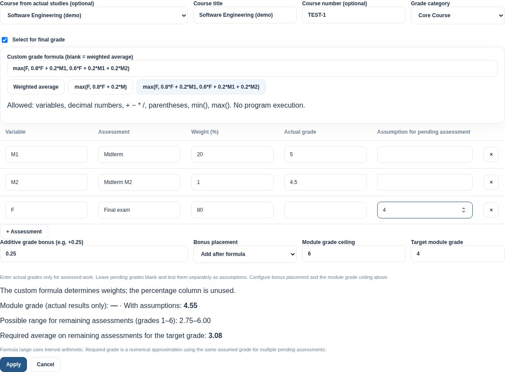
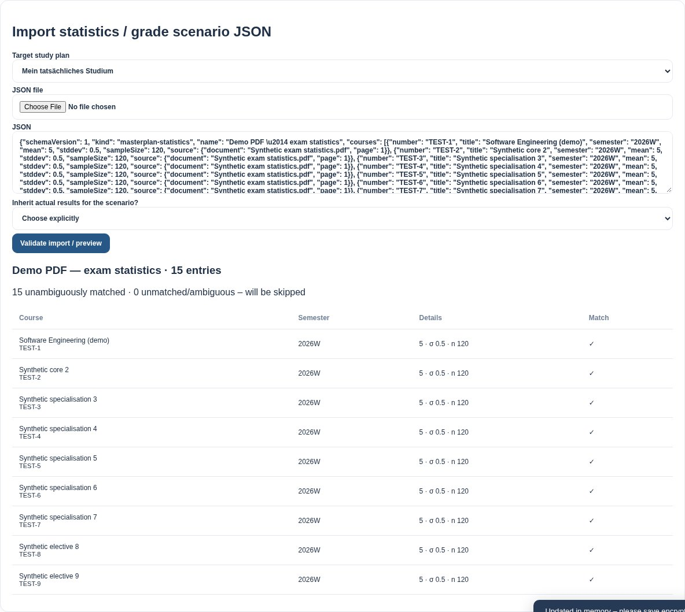
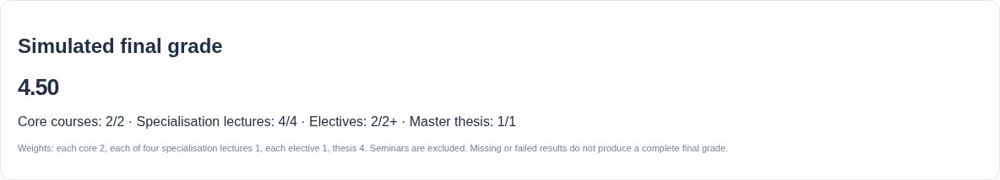
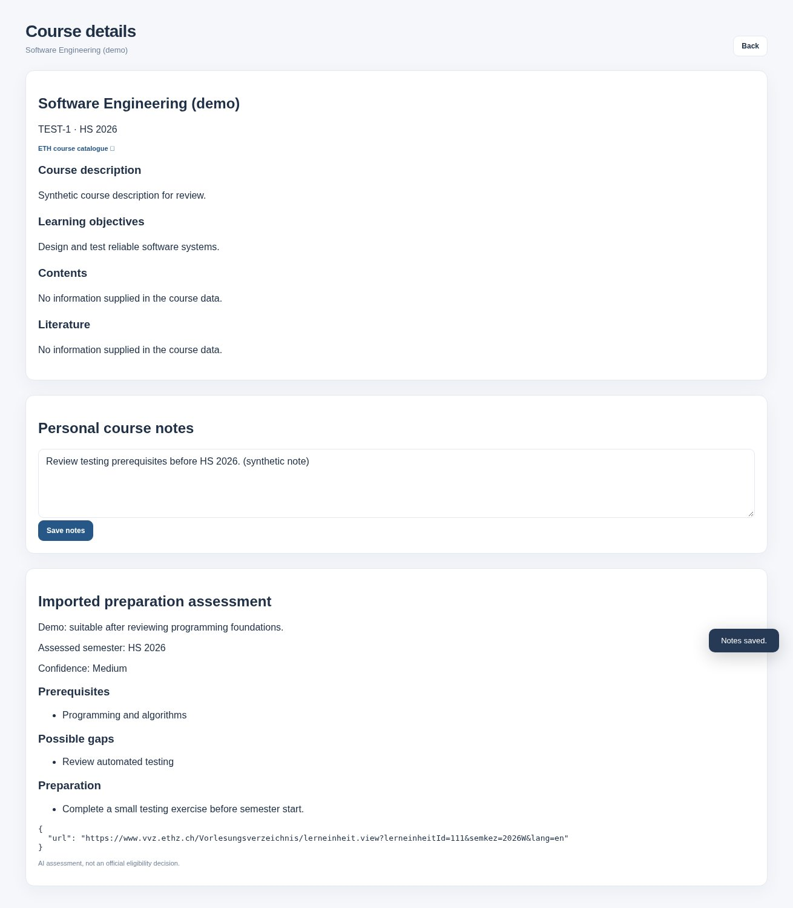
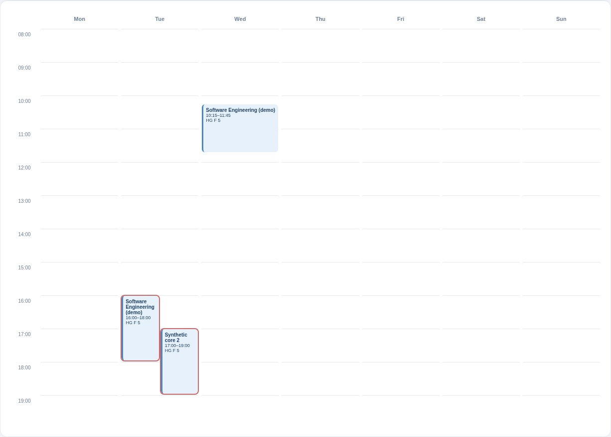

# Browser review evidence

Captured by `SCREENSHOT_DIR=docs/screenshots python tests/browser_analytics.py`.
All courses, statistics, grades and notes shown here are synthetic. The browser runs the real
local HTTP server with a temporary catalogue and personal directory.

## Adaptive grading formula, components and bonus

## JSON import preview

## Master-grade calculation from a statistical scenario

Each final-grade course in this fixture has mean 5 and standard deviation 0.5. A factor of −1,
without inheriting real results, produces a simulated Master grade of 4.50.

## Separate course notes and preparation assessment

## Duration, quarter-hours and multiple meetings

The same course has Tuesday 16:00–18:00 and Wednesday 10:15–11:45 meetings. A second course
overlaps on Tuesday; both remain visible in separate lanes.

