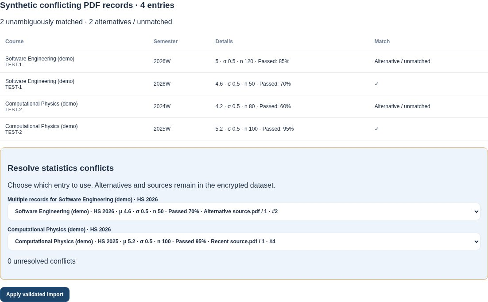
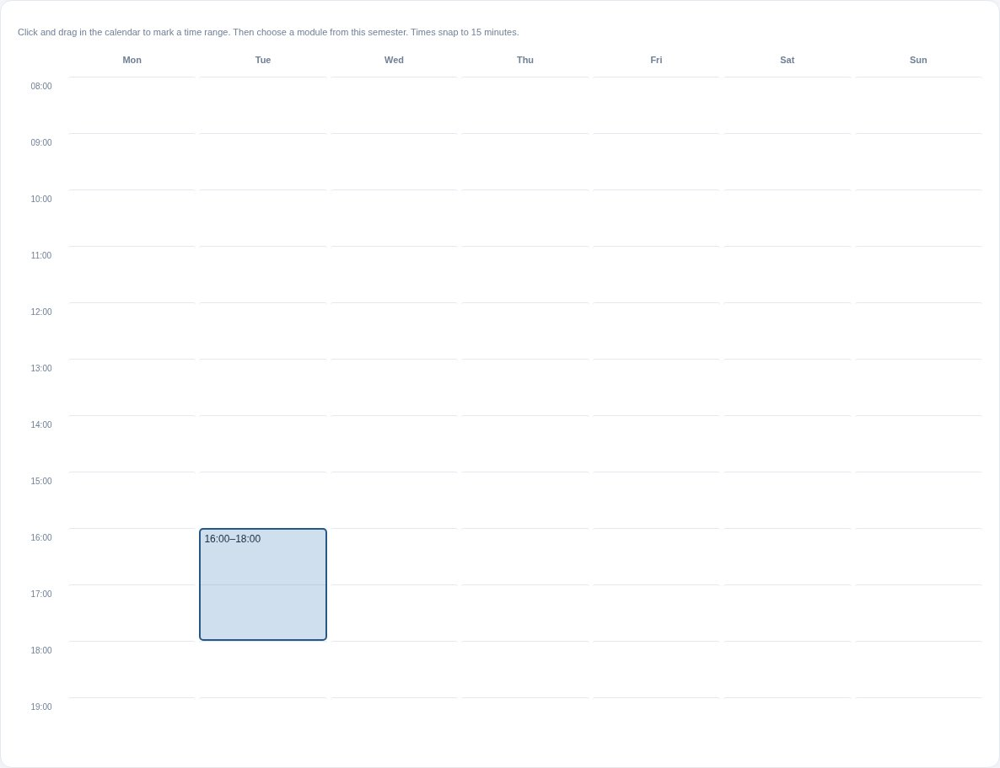
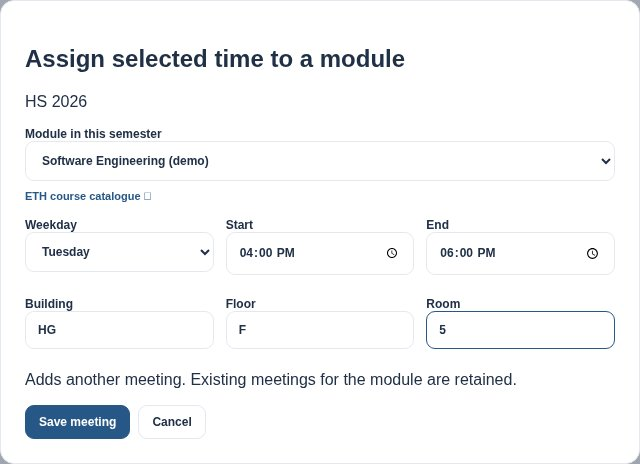
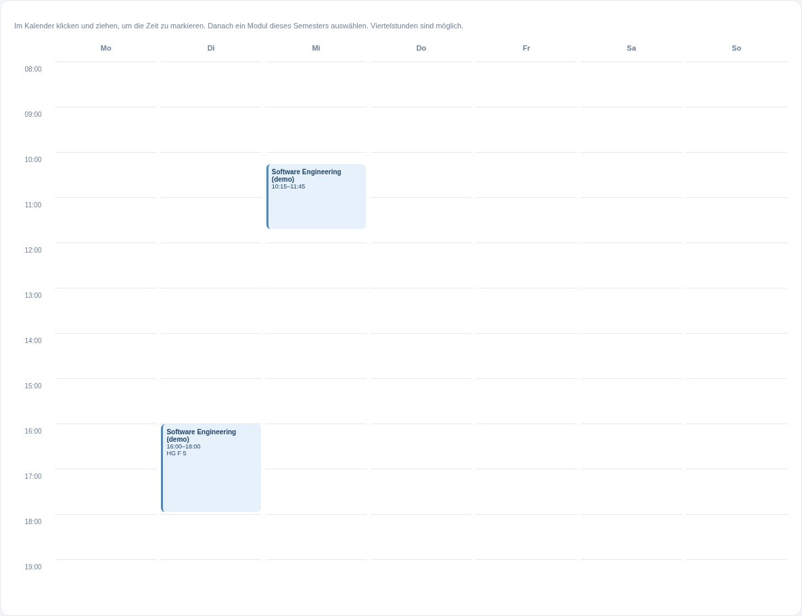

# Statistics choices and time-first calendar

Captured with `SCREENSHOT_DIR=docs/screenshots python tests/browser_conflicts_calendar.py`.
All courses, exam statistics, grades and sources are synthetic. The real application runs against
an isolated temporary HTTP server and personal directory.

## Choose a conflicting statistics source

The preview retains both duplicate records and both historical records. The selected source is
shown with mean, standard deviation, cohort size, overall module pass percentage and provenance.
Choices and all alternatives persist in the encrypted vault.

## Mark a time range directly in the calendar

## Choose the module for the marked time

The picker is restricted to courses assigned to this semester and includes an official VVZ link,
editable times and location fields. Saving adds a meeting without replacing existing meetings.

## Multiple meetings remain visible after reloading

The browser test additionally checks unresolved-conflict rejection, different-plan historical choices,
encrypted roundtrip, touch selection and horizontal panning on a phone-sized viewport, reverse
selection, keyboard activation, cancellation, locked/foreign-semester courses and invalid time ranges.
