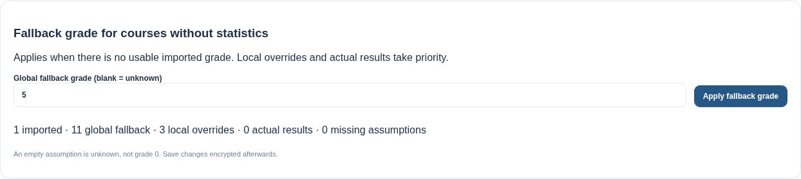
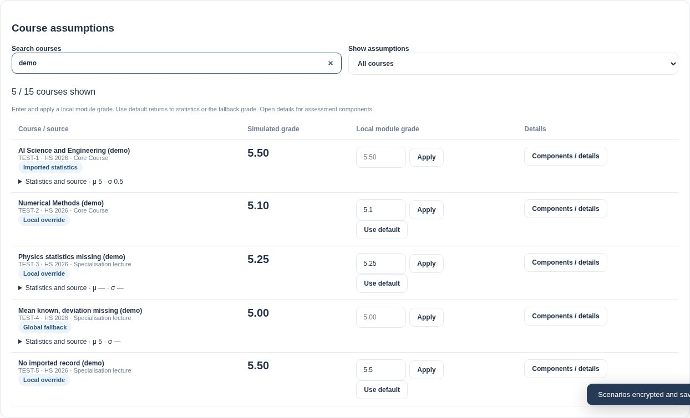

# Simulation defaults, overrides and saving

Captured with `SCREENSHOT_DIR=docs/screenshots python tests/browser_simulation_defaults.py`.
All grades, modules and statistics are synthetic, using the real app and a temporary HTTP server.

## Global fallback and coverage

The global grade fills courses without usable statistics. Counts distinguish imported values,
fallbacks, local overrides, actual results and missing assumptions.

## Local overrides and their sources

The compact table shows a usable imported statistic, manual grades for unmatched or incomplete
imports, a global fallback, inline overrides and the reset-to-default control. All three manual
grades in this fixture survive sigma changes.

## Save scenarios

The browser test saves two named scenarios, reloads/unlocks the encrypted vault, checks the selected
scenario and all local/default grades, then saves a pending component edit and verifies it again.

